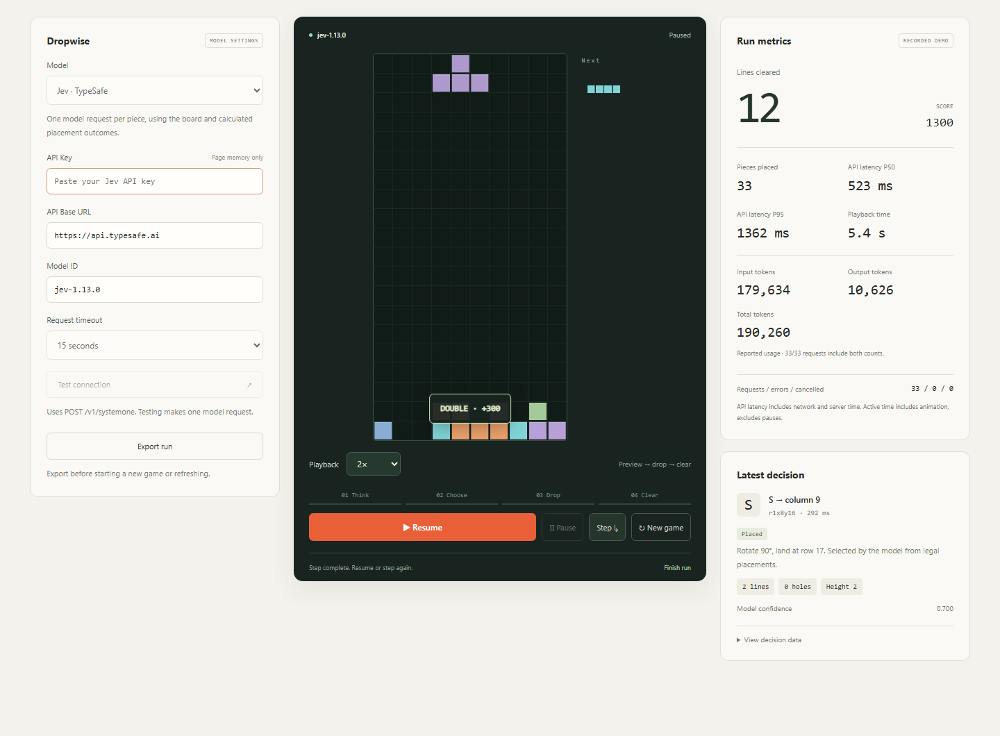

# Dropwise

Watch a model choose, drop, and clear. A local playground for Jev and compatible System One APIs, with no runtime dependencies.



*Screenshot of recorded Jev 1.13.0 decisions rendered in the app at 2× playback. Scores, API latency, and tokens come from the recorded run; playback time is not live API timing. This is a UI demo, not a performance claim.*

## Run

Requires Node.js 22+. Download or clone the repository, then:

```sh
npm start
```

Open http://127.0.0.1:8787 and enter your Jev API key. Defaults: `https://api.typesafe.ai` / `jev-latest`. For another service, select **Custom** and enter its URL, model ID, and optional key. It must support `POST /v1/systemone`; OpenAI Chat Completions is not supported. Set `PORT` to change the local port.

## Watch and compare

- **2×** playback by default; choose **1× / 4× / 8×** or **Fast** for immediate placement. Speed changes animations, not the model or its input. Reduced-motion settings disable animations.
- A dashed outline previews the chosen landing. The cycle highlights **Think → Choose → Drop → Clear**; cleared rows light up and show the score gained.
- **Step**, **Pause**, and **New game** control the run. Pausing cancels an unfinished move; resuming may request that piece again. Selected and executed decisions are labeled separately.
- Track lines, pieces, API latency P50/P95, active time, and input/output/total tokens. Missing usage is marked unreported or partial. Connection checks are excluded; received responses still count if their move is cancelled. Observed usage is not a billing total.
- **Export run** saves the trace and metrics as JSON. Runs stay in page memory: export before refreshing or starting a new game.

Each browser run gets a fresh seven-bag sequence. For repeatable comparisons, use the CLI with the same seeds, piece limit, and pinned model IDs. Compare multiple runs, not one lucky game. Active time includes animations; API latency includes network and service time.

## What the model does

Every piece makes one model request:

```text
Board → legal placements + calculated outcomes → model choice → execute → repeat
```

The request contains a 10×20 board (`.` empty, `#` occupied), current and next pieces, rotation shapes, rules, and all legal placements. The engine supplies exact clears, holes/depth, stack height, roughness, wells, and summaries of the known next piece's possibilities. Those summaries may describe different next moves; they are not one guaranteed continuation. No unknown future pieces or history are sent.

The model chooses an ID in `answers.move.choice`. There is no weighted score, candidate ranking, recommended answer, or fallback player. This evaluates **assisted decision-making**, not unaided spatial reasoning or real-time keyboard control. See [provider.mjs](src/provider.mjs) for the payload.

Rules: rotate clockwise at spawn, move horizontally, then descend straight down. No hold, wall kicks, or tucks. Gravity waits for the model; play ends when the next piece cannot spawn, or you finish the run. API errors pause play.

## CLI evaluation

Set `JEV_API_KEY` in a local `.env` (gitignored). Optional `JEV_BASE_URL` and `JEV_MODEL` select the service and model.

```sh
npm run evaluate -- --pieces 100 --seeds 2026,2027
npm run review -- output/evaluation-<timestamp>.json
npm test
```

Evaluation makes real API calls (up to 30 pieces on one seed by default). Reports in gitignored `output/` contain traces, scores, latency, per-call usage, and payload size. Review checks recorded moves and scores offline; it accepts browser exports too and does not rate decision quality. Tests use local fixtures and require no key.

Source is in `src/`, frontend assets in `src/public/`, and tests in `tests/`. No install or build step, browser automation, or external fonts are needed to run the app. The server binds to loopback. Browser keys stay in page memory and request handling; exports contain no keys. Switching providers clears the key.

[MIT License](LICENSE)
